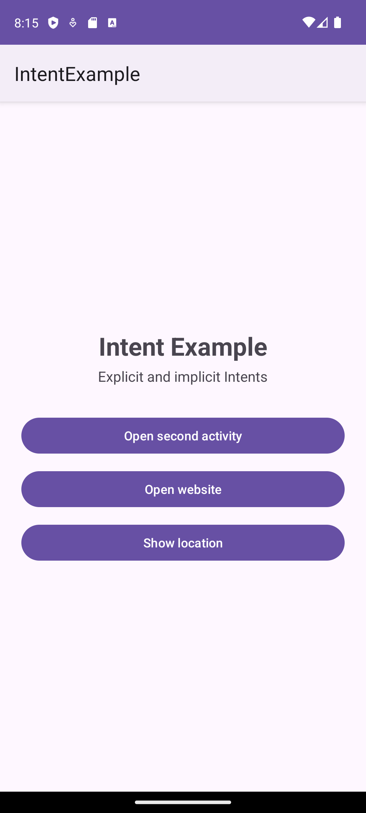
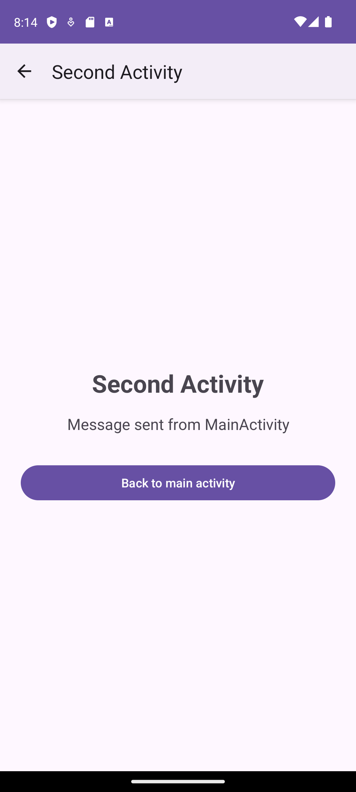
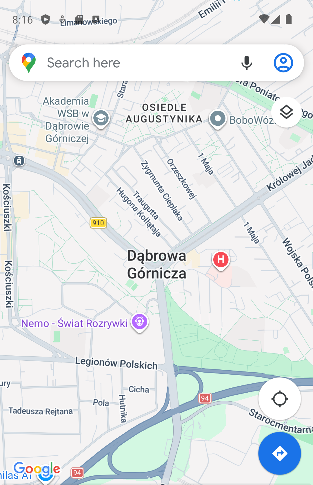

# IntentExample – Activities and Intents

Laboratory assignment: *First Android Application – Activities and Intents*
Course: NoRel Databases for Mobile Devices, WSB University
Author: Emad Abouelsaad (60051)

A minimal Android application in Java that shows two ways of starting another component:

- **Explicit Intent**: `MainActivity` opens `SecondActivity` by naming the class and passes a text message to it.
- **Implicit Intent**: `MainActivity` asks Android to open a website (`ACTION_VIEW` + `https://` URI) and, as the optional extension, a map location (`ACTION_VIEW` + `geo:` URI).

## Project settings

| Setting | Value |
|---|---|
| Name | IntentExample |
| Package | `pl.edu.intentexample` |
| Language | Java |
| Minimum SDK | API 24 (Android 7.0) |
| Target / compile SDK | API 36 |
| Build | Android Gradle Plugin 9.1.1, Gradle 9.3.1 |

## Source files

| File | Purpose |
|---|---|
| [`MainActivity.java`](app/src/main/java/pl/edu/intentexample/MainActivity.java) | Main screen with three buttons (explicit Intent, website, location) |
| [`SecondActivity.java`](app/src/main/java/pl/edu/intentexample/SecondActivity.java) | Reads the `MESSAGE` extra, shows it, and returns to the main screen |
| [`activity_main.xml`](app/src/main/res/layout/activity_main.xml) | Layout of the main screen |
| [`activity_second.xml`](app/src/main/res/layout/activity_second.xml) | Layout of the second screen |
| [`AndroidManifest.xml`](app/src/main/AndroidManifest.xml) | Declares both activities and the `<queries>` entry for `geo:` links |

## How it works

### Explicit Intent

```java
Intent intent = new Intent(MainActivity.this, SecondActivity.class);
intent.putExtra(EXTRA_MESSAGE, "Message sent from MainActivity");
startActivity(intent);
```

In `SecondActivity`:

```java
Intent intent = getIntent();
String message = intent.getStringExtra(MainActivity.EXTRA_MESSAGE);
tvMessage.setText(message);
```

The **Back to main activity** button calls `finish()`, which closes `SecondActivity` and returns to `MainActivity`.

### Implicit Intent: website

```java
Uri uri = Uri.parse("https://www.android.com");
Intent intent = new Intent(Intent.ACTION_VIEW, uri);
startActivity(intent);
```

If no browser is installed, an `ActivityNotFoundException` is caught and a Toast is shown.

### Implicit Intent: location (optional extension)

```java
Uri geoUri = Uri.parse("geo:50.3217,19.1949");
Intent intent = new Intent(Intent.ACTION_VIEW, geoUri);
if (intent.resolveActivity(getPackageManager()) != null) {
    startActivity(intent);
}
```

Since Android 11, an app only sees other apps that it declares it needs, so the manifest has a `<queries>` entry for `ACTION_VIEW` with the `geo` scheme. Without it, `resolveActivity()` would always return `null`.

## Screenshots

| Main activity | Explicit Intent + data | Implicit Intent: website | Implicit Intent: location |
|---|---|---|---|
|  |  |  |  |

Tested on the Android Emulator (Pixel 8, API 34).

## Explicit vs implicit Intent

| | Explicit Intent | Implicit Intent |
|---|---|---|
| Target | A specific class is named (`SecondActivity.class`) | No target is named; only an action and data (`ACTION_VIEW` + URI) |
| Who chooses the component | The developer | Android, based on the intent filters of installed apps |
| Typical use | Moving between screens of your own app | Asking another app to do something (open a web page, show a map, share, call) |
| Result if the target is missing | Compile error / crash, the class must exist in the app | Several apps may match (chooser), or none (must be handled) |

## Control question

**Why is an explicit Intent appropriate for launching a specific Activity inside your own application, while an implicit Intent can be used to open a web page?**

Inside my own application I know exactly which screen should open next, and that class is part of my code. Naming it directly in an explicit Intent is the simplest and safest choice. Android does not need to search for a matching component, no other app can take over the request, and the Activity does not have to be exported. Data can be passed safely with `putExtra()`.

Opening a web page is not the job of my application. I do not know which browser the user has installed, and I should not depend on one particular app. With an implicit Intent I only describe *what* I want (`ACTION_VIEW`) and *on what data* (an `https://` URI). Android then finds an application whose intent filter matches, such as Chrome or another browser, or lets the user choose. The same approach works for the `geo:` URI, which opens any installed map application.

## Running the project

1. Clone the repository and open the folder in Android Studio.
2. Wait for the Gradle sync to finish.
3. Start an emulator or connect a phone with USB debugging enabled.
4. Click **Run 'app'**.

From the command line: `./gradlew assembleDebug` builds `app/build/outputs/apk/debug/app-debug.apk`.
